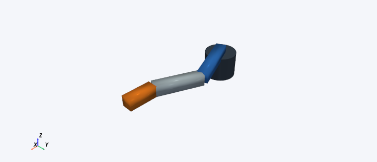

# Curated robot examples

Open **index.html** for the illustrated offline guide. In the application choose
**Open URDF** and browse to an example below. No Open Example toolbar button is needed.

Source location: `robots/curated/`. Installed Windows location:
`Windows Application/examples/curated/`. Shared ZIP location after extraction:
`URDF2DT/examples/curated/`. Keep this folder together when sharing the guide.

All body geometry is embedded in the URDF as boxes and cylinders: no mesh downloads,
ROS packages, textures, network connection or extra asset configuration are needed.
These are original MIT-licensed teaching assets, not manufacturer CAD or calibrated
hardware. See `ASSET_LICENCES.md` and the full `LICENSE`.

If you only see frames, enable **View → Scene layers → Robot meshes**, use **Show all**
in Model & Appearance, restore opacity, and use **Fit robot**. Empty tool/reference
links intentionally have no body. Screenshots below were captured from the app;
frames and labels were hidden for clarity. The image poses differ from exercise poses.

Use radians/metres for the exercises. Display rounding does not change calculations.
After each exercise, review and accept all DH frames in order, then run global FK
validation. Expect a sampled PASS at the bundled default tolerances for every active
chain. Read the dashboard scope: this is not collision, dynamics or hardware validation.
Save your project to a new folder rather than overwriting these examples.

## Three-joint serial arm

File: `serial_arm/serial_arm.urdf`

3 bounded revolute joints; link lengths 0.35, 0.28 and 0.17 m; 4 body visuals.

**Expected appearance:** A dark cylindrical base with blue, silver and orange solid arm links. Three rotary joints move a single planar chain. This is a teaching arm, not a UR5 or other manufacturer model.

Image pose: joint_1 = 0.4, joint_2 = -0.8, joint_3 = 0.4 rad.

**Exercise:** Open serial_arm/serial_arm.urdf. In Joint motion set joint_1 to 1.5707963267948966 rad (90 degrees) and joint_2/joint_3 to zero. Open FK calculator, use the URDF model, reference base and target tool, and calculate. The target position should be approximately [0.000, 0.800, 0.180] m. Reset the pose: it becomes [0.800, 0.000, 0.180] m. Inspect the orange body and try its opacity slider.

## RRPR SCARA

File: `scara/scara_rrpr.urdf`

4 movable joints: revolute, revolute, prismatic, continuous. Slide limits 0 to 0.18 m; 6 body visuals.

**Expected appearance:** A blue base and upper arm, silver forearm and vertical carriage, gold wrist and dark tool. Its vertical slide translates rather than rotating. Body geometry is schematic.

Image pose: shoulder = 0.5 rad, elbow = -0.8 rad, vertical_slide = 0.06 m, tool_yaw = 0.3 rad.

**Exercise:** Open scara/scara_rrpr.urdf. Reset all joints, then set vertical_slide to 0.100 m while shoulder, elbow and tool_yaw stay zero. Use FK calculator with the URDF model, reference world and target tool. Expect approximately [0.673, 0.127, 0.020] m. Reset vertical_slide to zero: target height is 0.120 m. A positive slide value moves the tool downward. Try the tool_yaw joint and observe that the tool rotates without changing its origin.

## Two-branch teaching robot

File: `branched_robot/branched_robot.urdf`

2 selectable paths, each with 2 bounded revolute joints; 4 movable joints in the whole tree; 6 body visuals.

**Expected appearance:** A dark base and silver torso with a blue arm and an orange arm extending from opposite sides. Both arms are visible together. Each arm is a two-joint serial path; the full tree is not treated as one DH chain.

Image pose: left_shoulder = 0.4 rad, left_elbow = 0.7 rad; inactive right arm at zero.

**Exercise:** Open branched_robot/branched_robot.urdf. Select base → left_tool in Robot Structure. Set left_shoulder to zero and left_elbow to 1.5707963267948966 rad. With URDF FK, reference base and target left_tool, expect approximately [0.280, 0.400, 0.400] m. The orange arm stays at its default pose. Switch the chain to base → right_tool; save first if prompted about changes. Set right_shoulder to zero and right_elbow to the same angle. Expect [-0.280, -0.400, 0.400] m for right_tool relative to base. The blue arm is now shown at its default pose.

