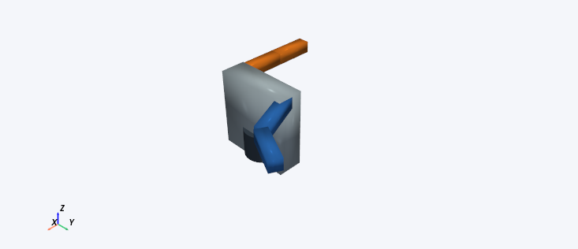

## Two-branch teaching robot

File: `branched_robot/branched_robot.urdf`

2 selectable paths, each with 2 bounded revolute joints; 4 movable joints in the whole tree; 6 body visuals.

**Expected appearance:** A dark base and silver torso with a blue arm and an orange arm extending from opposite sides. Both arms are visible together. Each arm is a two-joint serial path; the full tree is not treated as one DH chain.

Image pose: left_shoulder = 0.4 rad, left_elbow = 0.7 rad; inactive right arm at zero.

**Exercise:** Open branched_robot/branched_robot.urdf. Select base → left_tool in Robot Structure. Set left_shoulder to zero and left_elbow to 1.5707963267948966 rad. With URDF FK, reference base and target left_tool, expect approximately [0.280, 0.400, 0.400] m. The orange arm stays at its default pose. Switch the chain to base → right_tool; save first if prompted about changes. Set right_shoulder to zero and right_elbow to the same angle. Expect [-0.280, -0.400, 0.400] m for right_tool relative to base. The blue arm is now shown at its default pose.

Licence: original URDF2DT teaching geometry under MIT; see ../LICENSE and ../ASSET_LICENCES.md.
