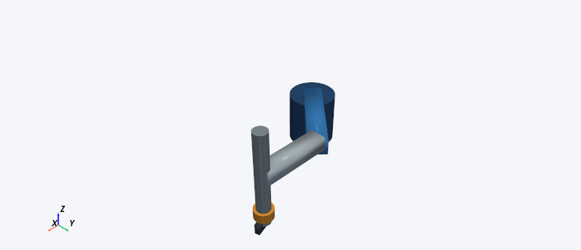

## RRPR SCARA

File: `scara/scara_rrpr.urdf`

4 movable joints: revolute, revolute, prismatic, continuous. Slide limits 0 to 0.18 m; 6 body visuals.

**Expected appearance:** A blue base and upper arm, silver forearm and vertical carriage, gold wrist and dark tool. Its vertical slide translates rather than rotating. Body geometry is schematic.

Image pose: shoulder = 0.5 rad, elbow = -0.8 rad, vertical_slide = 0.06 m, tool_yaw = 0.3 rad.

**Exercise:** Open scara/scara_rrpr.urdf. Reset all joints, then set vertical_slide to 0.100 m while shoulder, elbow and tool_yaw stay zero. Use FK calculator with the URDF model, reference world and target tool. Expect approximately [0.673, 0.127, 0.020] m. Reset vertical_slide to zero: target height is 0.120 m. A positive slide value moves the tool downward. Try the tool_yaw joint and observe that the tool rotates without changing its origin.

Licence: original URDF2DT teaching geometry under MIT; see ../LICENSE and ../ASSET_LICENCES.md.
